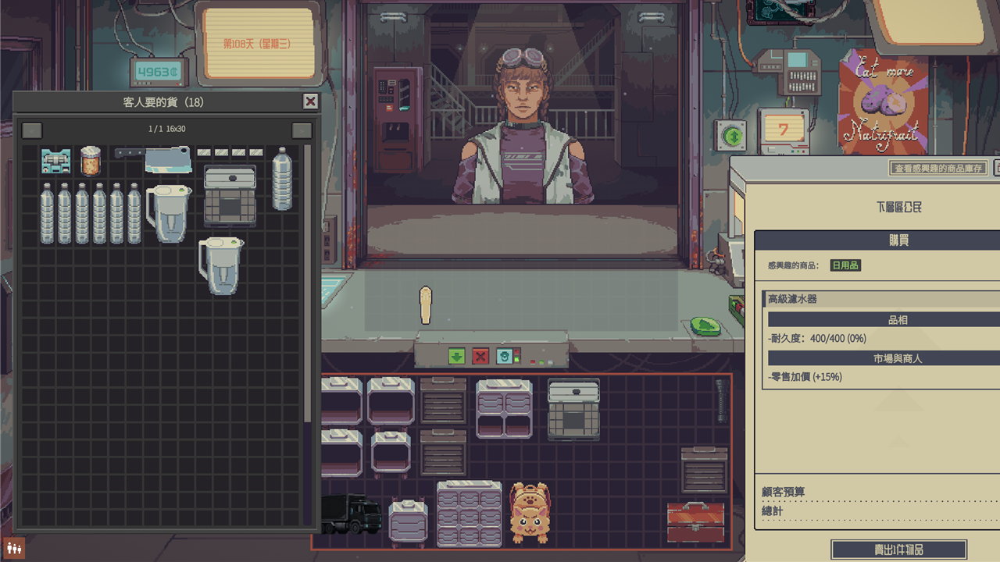

# Demand Panel

[繁體中文](README.zh-TW.md)

A mod for **Probably Stolen**. When a customer is at the counter, it opens a storage window that holds every item you own that this customer wants. Drag what you want to sell onto the counter. When you close the window, everything you did not sell goes back to where it came from.



## Features

- Collects wanted items from your main storage and the bags inside it, display cases, hidden compartments, the smuggling compartment, the fridge and freezer, and finished products waiting in machines (purified water, distillates, decoded cards, crafted items, DNA disks).
- Items over the customer's budget are listed after the ones they can afford.
- The window uses the game's own storage grid. Drag, rotate and stack items the same way as anywhere else in the game.
- Items stay in the window for as long as it is open, including items you drag back from the counter. Closing the window returns each unsold item to its original container and slot.
- Several pages when one page is full, with a vertical scrollbar and mouse wheel scrolling. Hold Shift to scroll sideways.
- The window remembers where you moved it until you quit the game.
- Special customers:
  - Gunsmith gun orders: complete guns, gun frames, loose weapon mods and gun parts.
  - Gunsmith modification service: loose weapon mods and gun parts.
  - Barter: items that match the customer's conditions.
  - A few known barter and dialogue customers that ask for one specific item.

Not listed: batteries powering machines, installed modules, filters, ingredient and work slots, batteries for sale in chargers, live animals and fish, vending machine stock, and equipped gear.

## Usage

1. Wait for a customer to come to the counter.
2. Press **F4**, or press **View Wanted Stock** on the negotiation tablet.
3. Drag items onto the counter.
4. Close the window when you are done. Unsold items go back.

The window does not open while security is in the store.

## Settings

In the game's mod settings, under **Demand Panel**:

| Setting | Default | Range |
|---|---|---|
| Toggle demand panel | F4 | Any key |
| Stock page columns | 16 | 4 to 64 |
| Stock page rows | 30 | 4 to 100 |

Page size changes apply the next time you open the window.

## Installation

**Steam Workshop:** subscribe to the mod, then activate it in the game's **Mods** menu and restart the game.

**Manual:** copy the `DemandPanel` folder into `Probably Stolen/Mods/`, then activate it in the **Mods** menu and restart the game.

Made for game version 0.46D.

## Building

Requires the .NET SDK and an installed copy of the game. The game folder is set in `Directory.Build.props`.

```powershell
dotnet build src/DemandPanel -c Release
dotnet test tests/DemandPanel.Core.Tests -c Release
```

`scripts/deploy.ps1` builds the mod and copies it into the game's `Mods/DemandPanel` folder. It deletes that folder first.

## License

[MIT](LICENSE)
