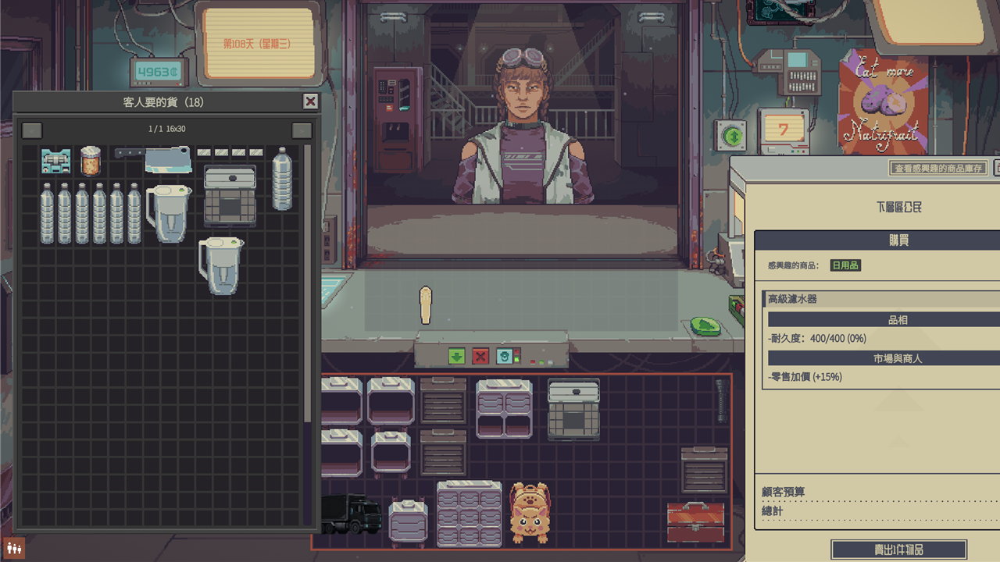

# Demand Panel

[English](README.md)

**Probably Stolen** 的模組。客人來到櫃檯時，打開一個儲物視窗，裡面是你擁有、而且這位客人想買的所有物品。把要賣的拖到櫃檯上。關掉視窗之後沒賣出的物品會回到原位。



## 功能

- 從主倉庫與裡面的包包、展示櫃、暗格、走私艙、冰箱冷藏與冷凍、機器裡等著取出的成品（淨水、蒸餾液、解序卡、製作成品、DNA 磁碟）找出客人要的物品。
- 超過客人預算的物品排在買得起的後面。
- 視窗用的是遊戲本身的儲物格子。拖曳、旋轉、堆疊的操作跟遊戲裡其他地方一樣。
- 視窗開著的期間物品都留在裡面，從櫃檯拖回來的也一樣。關掉視窗之後每件沒賣出的物品會回到原本的容器與格子。
- 一頁滿了就多一頁。可以用垂直捲軸或滑鼠滾輪捲動，按住 Shift 會左右捲動。
- 移動過的視窗位置會保留到關閉遊戲為止。
- 特殊客人：
  - 槍匠的整槍訂單：整把槍、槍胚、散裝武器模組、槍械零件。
  - 槍匠的改裝服務：散裝武器模組、槍械零件。
  - 以物易物：符合客人條件的物品。
  - 幾位指定要某一樣東西的以物易物與對話客人。

不會列出：供電中的電池、已安裝的模組、濾芯、原料與工作槽、充電器裡待售的電池、活體動物與魚、販賣機庫存、身上的裝備。

## 使用方式

1. 等客人來到櫃檯。
2. 按 **F4**，或按談判平板上的「查看感興趣的商品庫存」。
3. 把物品拖到櫃檯。
4. 賣完就關掉視窗。沒賣出的物品會回到原位。

保安在店裡時打不開視窗。

## 設定

在遊戲的模組設定裡，**Demand Panel** 底下：

| 設定 | 預設 | 範圍 |
|---|---|---|
| 開關需求面板 | F4 | 任一按鍵 |
| 庫存單頁列數 | 16 | 4 到 64 |
| 庫存單頁行數 | 30 | 4 到 100 |

改過的頁面大小要等下次打開視窗才會套用。

## 安裝

**Steam 工作坊：** 訂閱這個模組，在遊戲的 **Mods** 選單啟用它，再重新啟動遊戲。

**手動：** 把 `DemandPanel` 資料夾複製到 `Probably Stolen/Mods/`，在 **Mods** 選單啟用它，再重新啟動遊戲。

對應遊戲版本 0.46D。

## 建置

需要 .NET SDK 與已安裝的遊戲。遊戲資料夾設定在 `Directory.Build.props`。

```powershell
dotnet build src/DemandPanel -c Release
dotnet test tests/DemandPanel.Core.Tests -c Release
```

`scripts/deploy.ps1` 會建置模組並複製到遊戲的 `Mods/DemandPanel` 資料夾。它會先刪掉那個資料夾。

## 授權

[MIT](LICENSE)
